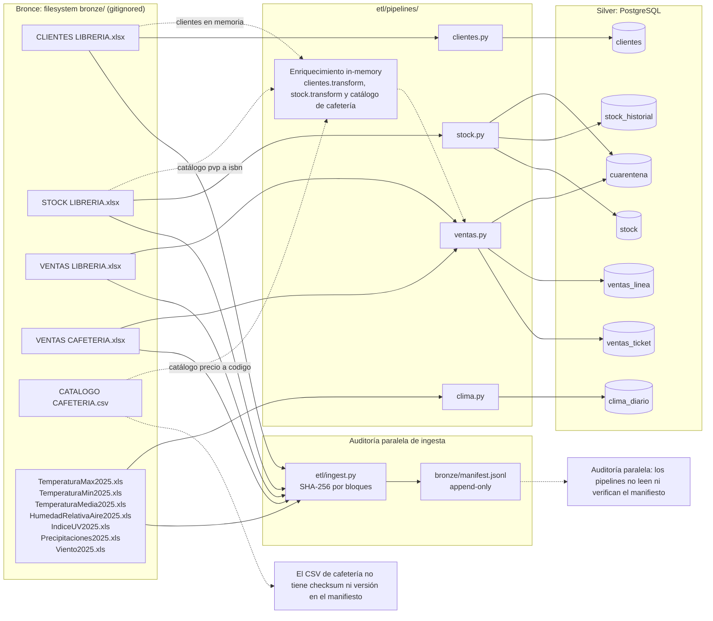
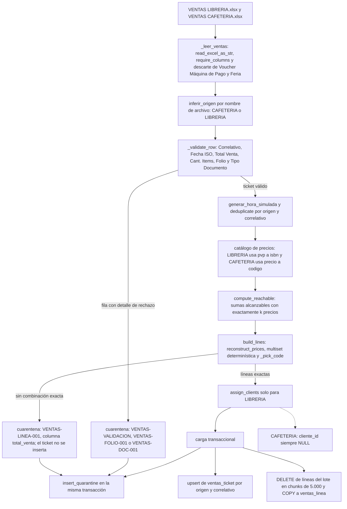

# Trazabilidad y Linaje de Datos de Miralibros

| Campo | Valor |
|---|---|
| Título | Trazabilidad y Linaje de Datos de Miralibros |
| Versión | 1.0.0 |
| Estado | vigente |
| Fecha | 2026-11-19 |
| Owner | `data-governance-steward` |
| Revisores | `silver-etl-engineer`, `data-quality-steward` |
| Alcance | Capa Bronce en el sistema de archivos local `bronze/` y capa Silver en PostgreSQL, schema configurable (default `silver`). La capa Gold no está implementada. |
| Fuera de alcance | Ejecución de pipelines, cambios de DDL, credenciales, valores de `.env` y datos personales reales. |
| Fuente de verdad | `etl/` y `sql/` del repositorio. El catálogo de datasets, owners, consumidores, clasificación PII y retención vive en `docs/catalogo_datos.md`; este documento lo complementa con el recorrido técnico del dato y no lo reemplaza. |

> **Nota de derivación.** Este documento se deriva de la implementación vigente de
> `etl/pipelines/`, `etl/quarantine.py`, `etl/db.py`, `etl/readers.py`, `etl/validators/` y `sql/`.
> No modifica código, DDL, tests ni archivos crudos. Si el código cambia, este documento debe
> actualizarse con una nueva versión. Las consultas de la sección 4.5 son de solo lectura y no se
> ejecutan desde aquí.

## Control de cambios

| Versión | Fecha | Cambio | Owner |
|---|---|---|---|
| 1.0.0 | 2026-11-19 | Versión inicial de trazabilidad y linaje, derivada de `etl/` y `sql/`. | `data-governance-steward` |

---

## 1. Alcance y arquitectura de trazabilidad

### 1.1 Qué responde este documento

| Pregunta | Respuesta documentada |
|---|---|
| ¿De qué archivo crudo sale cada tabla? | Sí, mediante el nombre exacto del archivo, el pipeline y el DDL. En Silver, `_source_file` solo existe en `stock`, `stock_historial` y `ventas_ticket`; en las demás tablas el vínculo es indirecto o no existe. |
| ¿De qué columna cruda sale cada columna Silver? | Sí, para las columnas efectivamente persistidas. Las columnas crudas descartadas se identifican como `Excluida`. |
| ¿Qué transformación y validación sufrió cada fila? | Sí, a nivel de función, validador y regla. El detalle exacto por fila no se conserva: solo queda el resultado en Silver o el rechazo en `cuarentena` cuando la entidad lo persiste. |
| ¿Dónde terminan los rechazos? | `stock` y `ventas` escriben en `{{schema}}.cuarentena`. `clientes` solo deja rastro en logs `DEBUG` y resumen `INFO`. `clima` convierte valores inválidos en `NULL` y no escribe cuarentena. |
| ¿Qué metadatos de auditoría existen realmente? | `_source_file`, `_loaded_at`, `updated_at`, `valid_from`, `valid_to` e `is_current`, según la tabla. No existe `load_id`, `run_id` ni `sha256` en Silver. |
| ¿Se puede unir una fila Silver con la versión exacta del archivo en el manifiesto? | No. `bronze/manifest.jsonl` se escribe en paralelo y los pipelines no lo leen ni lo verifican. `_source_file` guarda solo el basename, no el SHA-256 ni la versión. |

El inventario completo de datasets, owners, consumidores, criticidad y clasificación PII está en
`docs/catalogo_datos.md` (secciones 2, 3 y Anexo A). Este documento no repite ese catálogo.

### 1.2 Flujo end-to-end



Cada pipeline ejecuta su DDL `sql/<entidad>.sql` con el placeholder `{{schema}}` antes de escribir.
El diagrama omite esas aristas para no duplicar el flujo. La cuarentena de `stock` y `ventas` se
inserta en la misma transacción de carga, salvo en `--dry-run`, que no abre conexión.

### 1.3 Detalle del pipeline de ventas



---

## 2. Convenciones transversales de lectura y escritura

| Convención | Implementación real | Consecuencia para el linaje |
|---|---|---|
| Lectura Excel | `read_excel_as_str` usa `pd.read_excel(..., sheet_name=0, dtype=str, keep_default_na=False)`. | Todo valor llega como texto; no se infieren fechas, ceros a la izquierda ni tipos numéricos. Las celdas vacías quedan como cadena vacía. |
| Lectura CSV | `read_csv_as_str` usa `pd.read_csv(..., sep=',', dtype=str, keep_default_na=False, encoding='utf-8-sig')`. | Soporta BOM UTF-8 y conserva el texto crudo. Se usa para `CATALOGO CAFETERIA.csv`. |
| Lectura de clima | `read_html_grid_as_str` usa `lxml.html` y `itertext()`, no `pd.read_html`. | Conserva `s/p`, `CALMA`, comas decimales, ceros a la izquierda y celdas vacías. |
| Columnas obligatorias | `require_columns` compara nombres exactos y lanza `ValueError` con la lista de faltantes. | Si falta una columna obligatoria, el pipeline falla completo: no hay carga parcial. |
| Validadores | Devuelven el valor normalizado o `None`; no lanzan excepción por dato inválido. | El pipeline decide si descarta la fila, la deja en cuarentena o convierte el valor en `NULL`. |
| Placeholders | `is_placeholder` aplica el conjunto `PLACEHOLDERS`; los numéricos usan `NUMERIC_PLACEHOLDERS`. | Los textos se limpian; en numéricos, el vacío suele convertirse en `0` o `None` según la función. El valor `0` es placeholder solo en los textos. |
| DDL | Los archivos `sql/*.sql` usan `{{schema}}`. `execute_sql_file` lo reemplaza después de validar el schema con `^[A-Za-z_][A-Za-z0-9_]*$`. | El mismo DDL sirve para `silver` y para otros esquemas, sin hardcodear el nombre. |
| Identificadores SQL | Se construyen con `psycopg.sql.Identifier`; los valores viajan como parámetros. | No se concatenan nombres de tabla o schema con f-strings. |
| Escritura | `copy_rows` usa `COPY`, `upsert_table` usa una tabla temporal y `ON CONFLICT`, `replace_table` usa `TRUNCATE` + `COPY` en una transacción. | El modo de carga determina la idempotencia y el rastro de auditoría. |
| Transacciones | `replace_table` y `upsert_table` abren su propia transacción; en `ventas` y `stock` la carga, las líneas o el historial y la cuarentena comparten la transacción externa. | Un fallo de integridad revierte el lote completo, no solo la fila. |

El detalle de los conjuntos de placeholders y de las reglas de calidad está en
`docs/catalogo_datos.md` §2.1 y §4.2. Aquí solo se documenta su efecto sobre el linaje.

---

## 3. Linaje y reglas por entidad

### 3.1 Ventas

#### 3.1.1 Origen inferido

`inferir_origen` recibe la ruta del archivo, toma `Path(path).name`, lo pasa a mayúsculas y
reemplaza `Í` por `I`. Si el nombre contiene `CAFETERIA`, retorna `CAFETERIA`; si contiene
`LIBRERIA`, retorna `LIBRERIA`; en cualquier otro caso lanza `ValueError` y **no hay carga**.

`Origen` no es una columna obligatoria del archivo. Si el archivo trae una columna `Origen`, se
acepta como extra, no se exige y no llega a `ventas_ticket`.

#### 3.1.2 Columnas crudas y destino

Los archivos `VENTAS LIBRERIA.xlsx` y `VENTAS CAFETERIA.xlsx` tienen 14 columnas. El pipeline exige
solo `REQUIRED_COLUMNS`: `Correlativo`, `Fecha`, `Tipo Documento`, `Folio`, `Total Venta` y
`Cant. Items`. Las demás pueden faltar sin romper la lectura; cuando faltan, `row.get(...)` devuelve
vacío y el valor normalizado queda `NULL`.

| Columna cruda | ¿Obligatoria? | Tratamiento real | Destino Silver o exclusión |
|---|---|---|---|
| `Correlativo` | sí | `parse_integer(minimum=1)`; inválido genera `VENTAS-VALIDACION`. | `ventas_ticket.correlativo` |
| `Orden Web` | no | Se lee si existe. No se usa, no se valida y no se persiste. | Excluida |
| `Fecha` | sí | `parse_date_iso`: solo `YYYY-MM-DD` estricto; `dd/mm/yyyy` se rechaza. | `ventas_ticket.fecha` |
| `Medio de Pago` | no | `_clean_text`: colapsa espacios y convierte placeholders en `NULL`. No rechaza. | `ventas_ticket.medio_pago` |
| `Tipo Documento` | sí | `_clean_text`; se rechaza solo el valor literal `Sin Documento`, comparado sin mayúsculas y con espacios colapsados. Vacío pasa y queda `NULL`. | `ventas_ticket.tipo_documento` |
| `Folio` | sí | `VENTAS-FOLIO-001` si está vacío o si, tras quitar `.`, `,`, `-` y espacios, queda solo ceros. Si es no vacío y distinto de cero, se acepta como texto. | `ventas_ticket.folio` |
| `Voucher Máquina de Pago` | no | Se elimina de inmediato con `DROPPED_COLUMNS`: no se valida, no se persiste y no va a cuarentena. | Excluida |
| `Total Venta` | sí | `parse_non_negative_bigint(default=None)`: quita `.` y `,`; solo dígitos; inválido o negativo genera `VENTAS-VALIDACION`. | `ventas_ticket.total_venta` |
| `Cant. Items` | sí | `parse_integer(minimum=1)`; inválido genera `VENTAS-VALIDACION`. | `ventas_ticket.cant_items` |
| `Canal` | no | Se lee si existe, pero no se usa ni se persiste. `normalize_canal` existe en `ventas.py` y no se invoca en la validación. | Excluida |
| `Feria` | no | Se elimina de inmediato con `DROPPED_COLUMNS`: no se valida, no se persiste y no va a cuarentena. | Excluida |
| `Tiene Descuento` | no | `normalize_si_no`: `SI`, `SÍ` o `S` pasan a `SI`; `NO` o `N` pasan a `NO`; otro valor queda `NULL`, sin rechazo. | `ventas_ticket.tiene_descuento` |
| `Estado` | no | `_clean_text`; no rechaza. | `ventas_ticket.estado` |
| `Es Dev.` | no | `normalize_si_no`; otro valor queda `NULL`, sin rechazo. | `ventas_ticket.es_devolucion` |

La columna `Origen` de Silver se calcula con `inferir_origen`; no proviene de una columna cruda. La
`hora_simulada` se calcula con `generar_hora_simulada` y tampoco proviene del POS.

#### 3.1.3 Reglas y rechazos exactos

| Código | Columnas | Condición exacta | Motivo registrado | Destino |
|---|---|---|---|---|
| `VENTAS-VALIDACION` | `Correlativo`, `Fecha`, `Total Venta`, `Cant. Items` | `parse_integer` o `parse_date_iso` o `parse_non_negative_bigint` devuelven `None`. | `correlativo inválido`, `fecha inválida`, `total venta inválido o negativo` o `cantidad de ítems inválida`, según la columna. | `cuarentena`, una fila por detalle. |
| `VENTAS-FOLIO-001` | `Folio` | `_folio_invalido`: vacío o solo ceros tras quitar separadores. | `folio inválido o vacío`. | `cuarentena`, una fila por detalle. |
| `VENTAS-DOC-001` | `Tipo Documento` | `_sin_documento`: el texto colapsado y en minúsculas es exactamente `sin documento`. | `tipo documento sin documento`. | `cuarentena`, una fila por detalle. |
| `VENTAS-LINEA-001` | `total_venta` | No existe una combinación exacta de `cant_items` precios que sume `total_venta`. | `sin combinación exacta de líneas`. | `cuarentena`; el ticket no se inserta. |

Detalles operativos de los rechazos:

- La severidad es `error` en todos los casos.
- `fila` corresponde a la fila Excel 1-based: el encabezado es 1 y el primer dato es 2.
- `archivo_origen` es el basename del archivo, por ejemplo `VENTAS LIBRERIA.xlsx`.
- `entidad` es `ventas`.
- `transform` acumula todos los detalles de una fila; `_quarantine_by_file` agrupa por archivo y
  `flatten_rejections` genera **una fila de cuarentena por cada detalle**. Si una fila tiene varios
  errores, se insertan varias filas de cuarentena, todas con la misma `fila`.
- El ticket sin líneas exactas se agrega a `line_rejected` y se envía a cuarentena en la misma
  transacción de carga. No se inserta ni actualiza en `ventas_ticket`. Para `VENTAS-LINEA-001`,
  `fila` es la fila del ticket y `archivo_origen` es su archivo de origen.

#### 3.1.4 Duplicados por clave de negocio

Después de validar, `deduplicate` agrupa por `(origen, correlativo)` y conserva la última fila
vista. Registra un `WARNING` con el conteo y **no** envía duplicados a cuarentena. La fila
conservada es la que aporta `_source_file` al ticket.

Como la deduplicación es posterior a la validación, dos filas válidas con la misma clave producen
un solo ticket; dos filas inválidas con la misma clave producen sus propios detalles de cuarentena.

#### 3.1.5 Reconstrucción de líneas con bitsets

El detalle de `ventas_linea` no viene del POS. Se reconstruye de forma determinística a partir de
`total_venta` y `cant_items`:

1. `compute_reachable(prices, max_n, max_x)` construye `reachable[k]`, un bitset donde el bit `s`
   está encendido si se puede formar la suma `s` usando exactamente `k` precios, con repetición.
   Se trunca a `max_x` para acotar la memoria. `max_n` y `max_x` se calculan una sola vez sobre
   todos los tickets válidos del lote (ambos orígenes), no por ticket ni por origen; el mismo par se
   reutiliza para calcular el bitset de cada catálogo.
2. `reconstruct_prices(total, cant_items, prices, reachable)` recorre `k = cant_items .. 1` y elige
   el primer precio ordenado que deja un resto alcanzable con `k - 1` precios. Si no encuentra una
   combinación exacta, retorna `None`.
3. `build_lines(ticket, catalog, reachable, loaded_at)` convierte la multiset elegida en líneas:
   cuenta las repeticiones con `Counter`, ordena los precios distintos de menor a mayor y crea una
   línea por precio distinto. `linea` empieza en 1, `cantidad` es la multiplicidad y
   `total_linea = cantidad * precio_unitario`.
4. `_pick_code(origen, correlativo, linea, precio, codes)` elige el `codigo_interno` con
   `SHA-256` de la cadena `origen|correlativo|linea|precio`: toma los primeros 8 bytes del digest,
   calcula el módulo sobre la cantidad de códigos y elige dentro de la lista ordenada. No usa azar.
5. `build_lines` verifica el cuadre: la suma de `cantidad` debe ser igual a `cant_items` y la suma de
   `total_linea` debe ser igual a `total_venta`. Si no cuadra, registra `ERROR` y retorna `None`.

Si `build_lines` retorna `None`, el ticket no entra en `viable`, no se inserta en `ventas_ticket` y
se envía a cuarentena con `VENTAS-LINEA-001`, columna `total_venta`, motivo
`sin combinación exacta de líneas`.

Consecuencia de linaje: `ventas_linea` no tiene una columna de producto real. `codigo_interno` es
una elección determinística entre los códigos del mismo precio; no representa el mix real de
productos vendidos y no tiene FK.

#### 3.1.6 Catálogo de precios

| Origen | Archivo | Construcción | Uso |
|---|---|---|---|
| `LIBRERIA` | `bronze/STOCK LIBRERIA.xlsx` | `load_stock_catalog` lee el Excel, exige `stock.SOURCE_COLUMNS`, ejecuta `stock.transform` y arma pares `(pvp, isbn)` para las filas con ambos valores no nulos. | `_build_price_catalog` agrupa `pvp -> isbn` y ordena precios y códigos. |
| `CAFETERIA` | `bronze/CATALOGO CAFETERIA.csv` | `load_cafeteria_catalog` lee el CSV, exige `codigo` y `precio`, limpia `codigo` y parsea `precio`. | `_build_price_catalog` agrupa `precio -> codigo`. |

`_build_price_catalog` descarta precios negativos y códigos vacíos. En cafetería, una fila con
`codigo` nulo o `precio` inválido genera un `WARNING` y se omite en memoria; no va a cuarentena.
El catálogo de cafetería **no se persiste** en Silver y se pierden `nombre` y `categoria`.

#### 3.1.7 Asignación de clientes

`assign_clients(tickets, clients)` asigna `cliente_id` solo a tickets `LIBRERIA`. Los tickets
`CAFETERIA` son estrictamente anónimos y se cargan con `cliente_id = NULL`.

1. `load_clientes` lee `bronze/CLIENTES LIBRERIA.xlsx`, exige las 9 columnas de
   `clientes.SOURCE_COLUMNS` y ejecuta `clientes.transform`. Arma un diccionario `cliente_id ->
   Client`; si hay `cliente_id` duplicado, registra un `WARNING` y conserva la última fila.
2. Solo se lee el archivo de clientes si el lote tiene tickets `LIBRERIA` viables. Si no hay
   librería, no se abre el Excel de clientes.
3. Los clientes se ordenan por `compras` descendente y luego por `cliente_id`.
4. Son elegibles los clientes con `compras > 0` y `alta` no nula. Un cliente sin `alta` deja un
   `WARNING` y no participa.
5. Los candidatos de un cliente son los tickets no usados, con `fecha >= alta` y
   `total_venta <= compras`. Se ordenan por `total_venta` descendente, `origen` y `correlativo`.
6. `_subset_sum_indices` busca un subconjunto exacto de montos que sume `compras`. Tiene un límite
   de 250.000 iteraciones y 2,0 segundos. Si no hay combinación exacta o se supera el límite, el
   cliente queda sin asignar y se registra un `WARNING` con su `cliente_id`; el mensaje no incluye
   RUT. En el caso sin subconjunto, el `WARNING` sí muestra `compras` y la cantidad de tickets
   elegibles; en el timeout, solo el `cliente_id`.
7. Las asignaciones se guardan por `(origen, correlativo)`. Un ticket no usado por un cliente puede
   ser candidato de otro. Los tickets de `LIBRERIA` que no quedan asignados se cargan con
   `cliente_id = NULL`; el `WARNING` del cliente no expone RUT.

La asignación es un **cuadre histórico de montos**, no una identificación real de la persona que
compró. Un mismo ticket anónimo puede quedar asociado a un cliente por coincidencia de suma. Por
eso el `cliente_id` de `ventas_ticket` debe tratarse como seudónimo de análisis, no como prueba de
identidad.

Riesgo de carga: la asignación se hace en memoria con el Excel de clientes, sin consultar
`{{schema}}.clientes`. Si la tabla se cargó con otro archivo o con otra `PII_HASH_KEY`, la FK
`ventas_ticket_cliente_fk` puede fallar y abortar la transacción completa.

#### 3.1.8 Hora simulada

`generar_hora_simulada(origen, correlativo, fecha)` no proviene del POS:

- Si `fecha.weekday() == 6` (domingo), registra `WARNING` y retorna `None`.
- Calcula `SHA-256` de la cadena `origen|correlativo|fecha` y usa los primeros 8 bytes como entero.
- La ventana general es 10:00 a 19:00; el sábado cierra a las 18:00.
- Para `CAFETERIA`, el tramo principal es 12:00-14:00 y el secundario 17:00-cierre. Para
  `LIBRERIA`, el principal es 17:00-cierre y el secundario 12:00-14:00.
- Con `selector = valor % 100`: menos de 60 usa el tramo principal, menos de 80 el secundario y el
  resto elige entre 10:00-12:00 y 14:00-17:00 con un bit del hash.
- El minuto se elige de forma uniforme dentro del tramo.

Es determinística e idempotente por ticket: la misma terna produce la misma hora. No es un dato
observado y no debe usarse para reconstruir la operación real del local.

#### 3.1.9 Carga e idempotencia

- `--schema-only` ejecuta `sql/cuarentena.sql` y `sql/ventas.sql` y no lee archivos.
- `--dry-run` lee ambos archivos, valida, deduplica, reconstruye líneas, carga clientes en memoria y
  calcula la cuarentena, pero **no abre conexión** ni escribe.
- La carga real ejecuta el DDL de cuarentena y ventas, y luego una transacción con:
  1. `db.upsert_table` sobre `ventas_ticket`, con staging `ventas_ticket_staging`, clave
     `(origen, correlativo)` y actualización de todas las columnas de negocio más `_source_file`,
     `_loaded_at` y `updated_at`.
  2. `_delete_lines_for_batch`: borra las líneas de los tickets del lote en chunks de 5.000 tickets.
  3. `db.copy_rows` hacia `ventas_linea`.
  4. `insert_quarantine` por archivo, con la entidad `ventas`.
- `_loaded_at` y `updated_at` del ticket toman el mismo instante de inicio de la corrida.
- Si falla cualquier paso, la transacción revierte el lote completo.
- La idempotencia es por clave: reejecutar el mismo lote actualiza los tickets y reemplaza sus
  líneas. Un ticket que deja de ser viable en una corrida posterior **no se elimina** de la base,
  porque no entra en `viable` ni en el `DELETE` de líneas; su versión anterior permanece.

### 3.2 Clientes

#### 3.2.1 Columnas crudas y destino

`CLIENTES LIBRERIA.xlsx` tiene 9 columnas, todas exigidas por `require_columns`. Se persisten 8
columnas en `{{schema}}.clientes`; la identidad no se persiste.

| Columna cruda | ¿Obligatoria? | Transformación real | Destino Silver o exclusión |
|---|---|---|---|
| `Rut cliente` | sí | `normalize_rut`: mayúsculas; quita puntos, espacios y NBSP; acepta con o sin guion; cuerpo de 7 u 8 dígitos; DV módulo 11 válido. Luego `generar_cliente_id` aplica HMAC-SHA256 con `PII_HASH_KEY`. Inválido genera `RUT inválido`. | Solo en memoria; se persiste `clientes.cliente_id` (hexadecimal de 64). |
| `Nombre` | sí, por esquema | Se ignora por completo: no se valida, no rechaza y no se persiste. | Excluida |
| `Email` | sí, por esquema | Se ignora por completo: no se valida, no rechaza y no se persiste. | Excluida |
| `Alta` | sí | `parse_date_dmy`: `dd/mm/yyyy` o `dd-mm-yyyy`; mínimo `2000-01-01`. Inválida genera `alta inválida`. Si el año es posterior al año actual, deja `WARNING` y `alta = NULL`, pero la fila sigue válida. | `clientes.alta` |
| `Canal` | sí | `normalize_canal`: sin distinguir mayúsculas; `Local` o `Web`. Placeholder o distinto genera `canal inválido`. | `clientes.canal` |
| `Cumple.` | sí | `parse_day_month_es`: tolera acentos, mayúsculas, espacios y puntuación final; valida el día contra el mes. Solo se conserva el mes. Inválido deja `mes_cumple = NULL` y **no rechaza**. | `clientes.mes_cumple` |
| `Puntos` | sí | `parse_non_negative_bigint_or_zero`: vacío o placeholder pasan a 0; texto no numérico o negativo genera `puntos inválido`. | `clientes.puntos` |
| `Compras` | sí | `parse_non_negative_bigint_or_zero`; inválido genera `compras inválido`. | `clientes.compras` |
| `Canjes` | sí | `parse_non_negative_bigint_or_zero`; inválido genera `canjes inválido`. | `clientes.canjes` |

`Compras` es un **monto monetario histórico en CLP**, no la cantidad de transacciones. La `edad` no
viene de una columna: se calcula solo desde el RUT.

#### 3.2.2 Reglas de transformación

- `cliente_id`: HMAC-SHA256 del RUT normalizado (`cuerpo-DV`) con `PII_HASH_KEY`, en hexadecimal de
  64 caracteres. Es determinístico: la misma clave y el mismo RUT producen el mismo ID. Cambiar la
  clave cambia todos los IDs.
- `alta`: `parse_date_dmy` con mínimo `2000-01-01`. Si el **año** de la fecha es posterior al año
  actual, deja `alta = NULL` con `WARNING`; no invalida la fila. Una fecha inválida o anterior a 2000
  genera rechazo. Una fecha futura dentro del mismo año no se anula.
- `canal`: `Local` o `Web`; cualquier otro valor rechaza la fila.
- `Cumple.`: `parse_day_month_es` devuelve `(día, mes)`. Solo se conserva el mes si ambos son
  válidos; un valor no parseable deja `mes_cumple = NULL` y no rechaza.
- `edad`: `estimar_anio` normaliza el RUT, toma los primeros 3 dígitos del cuerpo, calcula
  `millones = int(cuerpo[:3]) / 10 ** (9 - len(cuerpo))` y recorre `EDAD_POR_TRAMO`. Según el tramo,
  asigna una edad asumida y calcula `año de nacimiento = reference_year - edad asumida`. Luego
  `edad = reference_year - year`. Se exige el rango 0-120. Es una **heurística**, no la edad real.
- `Puntos`, `Compras` y `Canjes`: vacío o placeholder pasan a 0; un valor no numérico o negativo
  rechaza la fila.

#### 3.2.3 Rechazos

Los motivos posibles son `RUT inválido`, `alta inválida`, `canal inválido`, `puntos inválido`,
`compras inválido`, `canjes inválido`, `año estimado inválido` y `edad inválida`. Si una fila tiene
varios, se concatenan con `; `.

`run()` llama a `transform` y **descarta la lista de rechazos** (`rows, _ = transform(...)`). Solo
queda el `DEBUG` por fila, con `cliente_id` o `sin_id`, y el resumen `INFO` con la cantidad de
válidas y descartadas. **No se escribe cuarentena** y no se conserva el valor crudo.

#### 3.2.4 Carga, deduplicación y límites

- La carga es un reemplazo total: `db.replace_table` ejecuta `TRUNCATE` + `COPY` en una única
  transacción. No hay historial, borrado lógico ni `_source_file`/`_loaded_at`.
- No hay deduplicación por RUT. Un RUT repetido genera el mismo `cliente_id`; al copiar dos filas
  con la misma PK, `COPY` viola `clientes_pkey` y aborta la transacción. El rollback conserva el
  contenido anterior de la tabla.
- `db.truncate_table` usa `TRUNCATE TABLE ... RESTART IDENTITY CASCADE`. Como
  `ventas_ticket.cliente_id` referencia `clientes`, una recarga de `clientes` ejecutada después de
  `ventas` arrastra las tablas dependientes (`ventas_ticket` y, por cadena, `ventas_linea`). El
  runner oficial ejecuta `clientes` antes de `ventas`; una ejecución aislada de `clientes` no evita
  este efecto.
- No hay índice adicional ni búsqueda por RUT: el RUT nunca se persiste.

### 3.3 Stock

#### 3.3.1 Columnas crudas y destino

`STOCK LIBRERIA.xlsx` tiene 10 columnas, todas exigidas por `require_columns`.

| Columna cruda | Transformación real | Destino Silver |
|---|---|---|
| `ISBN` | `normalize_isbn`: quita `-`, espacios y `.`; mayúsculas; solo valida forma: 13 dígitos, o 9 dígitos más dígito o `X`. No valida DV ni prefijo 978/979. Inválido o vacío genera `STOCK-VALIDACION`. | `stock.isbn` |
| `Titulo` | `_clean_text`: colapsa espacios; placeholder pasa a `NULL`. | `stock.titulo` |
| `Autor` | `_clean_text`; placeholder pasa a `NULL`. | `stock.autor` |
| `Editorial` | `_clean_text`; placeholder pasa a `NULL`. | `stock.editorial` |
| `Clasificación` | `_clean_text`; placeholder pasa a `NULL`. | `stock.clasificacion` |
| `PVP` | `parse_non_negative_bigint(default=None)`; el pipeline exige además `PVP >= 100`. Inválido o menor a 100 genera `STOCK-PVP-001`. | `stock.pvp` |
| `Stock Consig.` | `parse_non_negative_bigint_or_zero`: vacío o placeholder pasan a 0; inválido genera `STOCK-VALIDACION`. | `stock.stock_consignacion` |
| `Stock Propio` | `parse_non_negative_bigint_or_zero`; inválido genera `STOCK-VALIDACION`. | `stock.stock_propio` |
| `Stock Total` | `parse_non_negative_bigint(default=None)`; inválido o negativo genera `STOCK-VALIDACION`. Si no es exactamente `Stock Consig. + Stock Propio`, genera `STOCK-VALIDACION` con motivo `stock total inconsistente`. | `stock.stock_total` |
| `Ventas` | `parse_non_negative_bigint_or_zero`; inválido genera `STOCK-VALIDACION`. | `stock.ventas` |

El DDL solo exige `pvp >= 0`; el pipeline es más estricto y exige `pvp >= 100`. Un `PVP` entre 0 y
99 se rechaza en el pipeline aunque el DDL lo admitiría.

#### 3.3.2 Reglas y rechazos

| Código | Columnas | Condición exacta | Destino |
|---|---|---|---|
| `STOCK-VALIDACION` | `ISBN`, `Stock Consig.`, `Stock Propio`, `Stock Total`, `Ventas` | ISBN vacío o con forma inválida; stock inválido o negativo; `Stock Total` distinto de consignación más propio. | `cuarentena`, una fila por detalle, entidad `stock`. |
| `STOCK-PVP-001` | `PVP` | `PVP` inválido, negativo o menor a 100. | `cuarentena`, una fila por detalle, entidad `stock`. |

- La severidad es `error`; `fila` es la fila Excel 1-based desde 2.
- `archivo_origen` es el basename `STOCK LIBRERIA.xlsx`.
- `flatten_rejections` aplana los detalles y `insert_quarantine` inserta una fila por detalle.
- **Duplicados por ISBN**: `deduplicate` conserva la última fila, registra `WARNING` y **no** los
  envía a cuarentena.

#### 3.3.3 Carga incremental y SCD2

- `--dry-run` lee, valida, deduplica y calcula la cuarentena; no abre conexión.
- La carga real ejecuta `sql/cuarentena.sql` y `sql/stock.sql`, y luego una transacción con:
  1. `db.upsert_table` sobre `stock`, staging `stock_staging`, clave `isbn`. Se actualizan todas las
     columnas de negocio más `updated_at`, `_source_file` y `_loaded_at`; `valid_from` **no** se
     actualiza en el conflicto.
  2. `_refresh_history` para mantener `stock_historial`.
  3. `insert_quarantine` con entidad `stock`.
- `_refresh_history` usa dos comparaciones null-safe sobre `HISTORY_COMPARE_COLUMNS`: `titulo`,
  `autor`, `editorial`, `clasificacion`, `pvp`, `stock_consignacion`, `stock_propio`, `stock_total`
  y `ventas`.
  - **Cierre**: cierra la versión vigente si **cualquier** columna cambió, con
    `IS DISTINCT FROM` unidas con `OR`. `valid_to` toma el `updated_at` de la carga y
    `is_current` pasa a `FALSE`.
  - **Alta**: abre una versión nueva solo si **no existe** una versión vigente idéntica, con
    `IS NOT DISTINCT FROM` unidas con `AND`. `valid_from` toma el `updated_at` de la carga,
    `valid_to` queda `NULL`, `is_current` queda `TRUE` y se copian `_source_file` y `_loaded_at`
    desde `stock`.
- El índice único parcial `stock_historial_isbn_actual_uidx (isbn) WHERE is_current` garantiza una
  sola versión vigente por ISBN.
- No se historizan ausencias: si un ISBN deja de venir en el archivo, su versión vigente no se
  cierra.
- `stock._source_file` y `stock_historial._source_file` guardan el basename; no guardan ruta ni
  SHA-256.

### 3.4 Clima

#### 3.4.1 Archivos y columnas

Los 7 archivos viven en `bronze/` y son tablas HTML con extensión `.xls`. Se leen con
`read_html_grid_as_str`, que exige una grilla con encabezado `Dia` y 12 meses, exactamente 13
columnas y los días 1 a 31. Si no se cumple, lanza `ValueError`. Si falta uno de los 7 archivos,
`read_html_grid_as_str` lanza `FileNotFoundError` y no hay carga.

| Archivo | Variable | Columna Silver |
|---|---|---|
| `TemperaturaMax2025.xls` | Temperatura máxima | `temp_max` |
| `TemperaturaMin2025.xls` | Temperatura mínima | `temp_min` |
| `TemperaturaMedia2025.xls` | Temperatura media | `temp_media` |
| `HumedadRelativaAire2025.xls` | Humedad relativa | `humedad_relativa` |
| `IndiceUV2025.xls` | Índice UV | `indice_uv` |
| `Precipitaciones2025.xls` | Precipitación | `precipitacion_mm` |
| `Viento2025.xls` | Viento | `viento_direccion`, `viento_velocidad_kt` |

#### 3.4.2 Transformaciones

- `load_grid` recorre `Dia` y los 12 meses. Para cada celda intenta `date(year, month, day)`; si la
  fecha no existe (29/02 en año no bisiesto, 31/04, etc.), omite esa celda. El año es fijo:
  `YEAR = 2025`.
- `build_calendar(2025)` genera todas las fechas reales del año: 365 filas. Para cada fecha, toma el
  valor de cada archivo con `.get(fecha)`.
- Temperaturas: `parse_decimal` con rango -50 a 60. Inválido pasa a `NULL`.
- Humedad: `parse_decimal` con rango 0 a 100. Inválido pasa a `NULL`.
- UV: `parse_integer` con rango 0 a 20. Un punto `.` está en `NUMERIC_PLACEHOLDERS` y pasa a `NULL`.
- Precipitación: `s/p` pasa a `0.0 mm`; el resto usa `parse_decimal` con mínimo 0. Inválido pasa a
  `NULL`.
- Viento: `CALMA` produce dirección `CALMA` y velocidad 0; el formato `DIRECCION/velocidad` exige
  dirección en `N`, `NE`, `E`, `SE`, `S`, `SW`, `W`, `NW` o `VRB` y velocidad entera mayor o igual
  a 0. Un valor malformado produce `(NULL, NULL)`.
- Los valores inválidos **no van a cuarentena**: quedan `NULL` y no se registra el valor crudo.

#### 3.4.3 Carga y límites

- `--dry-run` lee los 7 archivos, arma la grilla y cuenta nulos; no abre conexión.
- La carga real ejecuta `sql/clima.sql` y hace `db.upsert_table` sobre `clima_diario`, staging
  `clima_staging`, clave `fecha`. Actualiza las 8 mediciones y `_loaded_at`.
- No borra años anteriores: el upsert solo toca las fechas presentes en el lote.
- No existe `_source_file` en `clima_diario`: no se puede saber de qué archivo provino cada valor
  mirando solo Silver. La relación archivo-columna está en el código (`SOURCES`) y en la tabla de
  arriba.
- Los `CHECK` de coherencia (`temp_min <= temp_max` y `temp_media` entre ambas) son solo de
  PostgreSQL. El pipeline no los valida; una fila incoherente puede abortar el lote completo.
- `_loaded_at` es el único metadato de auditoría de la tabla.

### 3.5 Cuarentena

#### 3.5.1 Contrato de la tabla

`{{schema}}.cuarentena` es una tabla común, append-only, escrita por `stock` y `ventas`.

| Campo | Contenido real |
|---|---|
| `id` | `BIGINT GENERATED ALWAYS AS IDENTITY`, PK. |
| `entidad` | `stock` o `ventas`. `clientes` y `clima` no escriben. |
| `archivo_origen` | Basename del archivo; en ventas agrupa los rechazos por archivo. |
| `fila` | Fila Excel 1-based: encabezado 1, primer dato 2. |
| `columna` | Nombre de la columna cruda que originó el detalle. |
| `valor_crudo` | `str(valor)` del valor rechazado. Puede contener PII si una entidad futura la escribe. |
| `regla` | Código de regla; `SIN-REGLA` si falta. |
| `severidad` | `error` o `warning`; hoy los pipelines usan `error`. |
| `motivo` | Texto legible del rechazo. |
| `_loaded_at` | Instante UTC de la inserción. |

- `flatten_rejections` toma `detalles` de cada rechazo; si no existe, usa el propio rechazo. Genera
  una fila por detalle con las claves `fila`, `columna`, `valor_crudo`, `regla`, `severidad` y
  `motivo`.
- `insert_quarantine` usa `executemany` con identificadores `psycopg.sql.Identifier` y valores como
  parámetros. No escribe `id` ni `_loaded_at`: los genera la base.
- Índice `cuarentena_entidad_loaded_at_idx (entidad, _loaded_at DESC)`.
- **No hay clave natural, `run_id` ni SHA-256.** Una recarga vuelve a insertar los mismos rechazos.
  No se puede deduplicar por ticket o ISBN ni reconstruir la corrida exacta.
- `clientes` y `clima` no escriben cuarentena. En `clientes` los rechazos se descartan; en `clima`
  los valores inválidos se convierten en `NULL`.

### 3.6 Cruce PII del linaje

La clasificación completa y la política de enmascaramiento viven en `docs/catalogo_datos.md`
Anexo A. Esta tabla solo verifica las columnas PII que atraviesan el linaje de Bronce a Silver.

| Columna en el linaje | Nivel | Transformación y persistencia | Enmascaramiento propuesto | Ejemplo ficticio antes / después |
|---|---|---|---|---|
| `Rut cliente` | alta | `normalize_rut` y HMAC-SHA256; el RUT no se persiste. | Conservar últimos 3 dígitos del cuerpo y el DV. | `12.345.678-5` / `*****678-5` |
| `Nombre` | alta | Ignorado; no se persiste. | Inicial más `***` por palabra. | `Ana Pérez` / `A*** P***` |
| `Email` | alta | Ignorado; no se persiste. | Primera letra y dominio visible. | `ana.perez@example.com` / `a***@example.com` |
| `Cumple.` | media | Solo se conserva el mes en `clientes.mes_cumple`. | Mes sin día ni año. | `14 - junio` / `06` |
| `Alta` | baja | `clientes.alta`, fecha completa. | Año y mes; día enmascarado en reportes. | `15/03/2024` / `2024-03-**` |
| `cliente_id` | baja | HMAC-SHA256 de 64 hexadecimales en `clientes` y `ventas_ticket`. | Completo solo en cruces internos; externo, primeros 8 caracteres. | `a1b2c3d4e5f6...` / `a1b2c3d4...` |
| `edad` | baja | Derivada solo del RUT, rango 0-120. | Rango de 10 años en reportes. | `68` / `65-74` |
| `valor_crudo` | media | Cuarentena; variable, puede contener PII si una entidad futura la escribe. | Truncar y enmascarar si contiene PII. | `12.345.678-5` / `*****678-5` |
| `autor` | baja | `stock.autor`, dato profesional público. | Sin máscara; no se usa para identificar personas. | `Autora Ficticia` / `Autora Ficticia` |

No existen columnas de teléfono ni dirección en los crudos inventariados. Si se incorporan, deben
clasificarse como `media` y aplicar la misma política del Anexo A.

Verificación de clasificación:

| Artefacto | Columnas PII | Resultado |
|---|---|---|
| `sql/clientes.sql` | `cliente_id` (baja), `alta` (baja), `edad` (baja), `mes_cumple` (media), `puntos`, `compras`, `canjes` (baja) | Clasificadas. |
| `sql/ventas.sql` | `cliente_id` (baja) | Clasificada. |
| `sql/stock.sql` | `autor` (baja) | Clasificada como dato profesional. |
| `sql/clima.sql` | Ninguna | No aplica. |
| `sql/cuarentena.sql` | `valor_crudo` (media) | Clasificada. |
| Marts Gold propuestos | No existen | Cuando se creen, el Anexo A es el contrato de enmascaramiento. |

Resultado del cruce: no se detectó `columna con PII sin clasificar` en `sql/` ni en los marts
propuestos. Tampoco se detectó `dataset sin dueño asignado` en el alcance de este documento; los
owners están en `docs/catalogo_datos.md`.

La referencia a Ley 19.628 y Ley 21.719 es orientación técnica para controles y minimización, no
una declaración de certificación ni de cumplimiento normativo.

---

## 4. Trazabilidad operativa y auditoría

### 4.1 Matriz real de metadatos por tabla

| Tabla | `_source_file` | `_loaded_at` | `updated_at` | `valid_from` | `valid_to` | `is_current` |
|---|---|---|---|---|---|---|
| `clientes` | no | no | no | no | no | no |
| `stock` | sí | sí | sí | sí | no | no |
| `stock_historial` | sí | sí | no | sí | sí | sí |
| `ventas_ticket` | sí | sí | sí | no | no | no |
| `ventas_linea` | no | sí | no | no | no | no |
| `clima_diario` | no | sí | no | no | no | no |
| `cuarentena` | no (`archivo_origen`) | sí | no | no | no | no |

`_source_file` guarda solo el basename, nunca la ruta ni el SHA-256. `_loaded_at` guarda el instante
UTC de la carga, no un identificador de corrida. `updated_at` indica la última vez que el pipeline
vio o actualizó la fila. En `stock`, `valid_from` es la primera carga del ISBN y no cambia en el
upsert; en `stock_historial`, marca el inicio de la versión.

### 4.2 Claves de negocio y modos de carga

| Entidad | Clave / grano | Modo real | Idempotencia observada |
|---|---|---|---|
| `clientes` | `cliente_id` (PK) | `db.replace_table`: `TRUNCATE` + `COPY` en una transacción. | Reejecutar vuelve a calcular y reescribe todo; no hay historial ni comparación con la carga previa. |
| `stock` | `isbn` (PK) | `db.upsert_table` por `isbn`; `valid_from` no se actualiza; `updated_at` y `_loaded_at` sí. | Reejecutar actualiza las filas y refresca `updated_at`. No detecta ausencias. |
| `stock_historial` | `id` (PK); una versión por ISBN | `_refresh_history` cierra y abre versiones en la misma transacción. | Una corrida idéntica no duplica la versión vigente. No historiza ausencias. |
| `ventas_ticket` | `(origen, correlativo)` (PK) | `db.upsert_table` por `(origen, correlativo)`; actualiza negocio, `_source_file`, `_loaded_at` y `updated_at`. | Reejecutar el mismo lote actualiza los tickets. |
| `ventas_linea` | `(origen, correlativo, linea)` (PK) | `DELETE` de las líneas de los tickets del lote en chunks de 5.000 y `COPY`. | Reejecutar reemplaza las líneas de los tickets viables. Un ticket no viable no se borra. |
| `clima_diario` | `fecha` (PK) | `db.upsert_table` por `fecha`; no borra años anteriores. | Reejecutar actualiza las fechas del lote. |
| `cuarentena` | `id` (PK); sin clave natural | Append-only con `executemany`. | No es idempotente: cada recarga inserta de nuevo los mismos rechazos. |

Detalle de `ventas_linea`: la FK compuesta a `ventas_ticket` es `ON DELETE CASCADE`, pero el
pipeline no borra tickets; borra líneas por lote. Las líneas se insertan con `COPY` y no tienen
`_source_file`.

### 4.3 Manifiesto e ingesta

`etl/ingest.py` calcula SHA-256 por bloques de 1 MiB y mantiene `bronze/manifest.jsonl` append-only.
No mueve, renombra ni transforma archivos, y no toca la base de datos.

| Campo del manifiesto | Contenido real |
|---|---|
| `archivo` | Basename. |
| `ruta_relativa` | Ruta relativa a la raíz del repo o al directorio de entrada, con separadores `/`. |
| `tamano_bytes` | Tamaño del archivo. |
| `mtime_utc` | Fecha de modificación en ISO 8601 UTC. |
| `sha256` | Hash hexadecimal. |
| `ingerido_en_utc` | Instante de ingesta en ISO 8601 UTC. |
| `entidad` | Inferida del nombre: `clientes`, `stock`, `ventas_libreria`, `ventas_cafeteria`, `clima_temp_max`, `clima_temp_min`, `clima_temp_media`, `clima_humedad_relativa`, `clima_indice_uv`, `clima_precipitaciones`, `clima_viento` o `desconocido`. |
| `formato` | Detectado por bytes: `xlsx` si empieza con la firma `PK\x03\x04`, `html` si los primeros 1024 bytes contienen `<html` o `<table`, `desconocido` en otro caso. |
| `version` | 1 en la primera aparición; incrementa con cada contenido nuevo. |
| `hash_anterior` | SHA-256 de la versión previa, o `null`. |
| `estado` | `nuevo` o `nueva_version`. |

Reglas:

- Solo se listan archivos con extensión `.xlsx` o `.xls`. El CSV de cafetería **no entra** al
  manifiesto: no tiene checksum ni versión.
- Los 7 `.xls` de clima **sí entran**, con `formato = html`, porque son tablas HTML con extensión de
  Excel.
- Si el SHA-256 coincide con la última versión del mismo nombre, no se escribe línea. Si difiere, se
  agrega `version + 1` con `hash_anterior`.
- Los pipelines **no leen** `manifest.jsonl` y no verifican el SHA-256 antes de cargar. El manifiesto
  es una auditoría paralela, no un contrato de carga.

### 4.4 Brecha central de linaje

No existe `load_id`, `run_id` ni `sha256` en Silver. `_source_file` es solo el basename y
`_loaded_at` no identifica de forma única una corrida. Por lo tanto:

- No se puede unir una fila de `stock`, `stock_historial` o `ventas_ticket` con la versión exacta
  del archivo registrada en `manifest.jsonl`.
- No se puede demostrar que la fila cargada corresponda al último SHA-256 del manifiesto.
- No se puede deduplicar `cuarentena` por corrida ni por clave natural.
- La reconstrucción completa del linaje exige comparar manualmente el basename, la fecha de carga y
  el historial del manifiesto; no es una relación verificable por SQL.

### 4.5 Consultas de verificación de solo lectura

Las consultas usan el placeholder `{{schema}}`; reemplazarlo por el schema real (`silver` o el valor
de `PG_SCHEMA`). No modifican datos y no se ejecutan desde este documento.

#### 4.5.1 Cuadre de ticket contra líneas

```sql
SELECT
    t.origen,
    t.correlativo,
    t.cant_items,
    t.total_venta,
    COUNT(l.linea) AS lineas,
    COALESCE(SUM(l.cantidad), 0) AS suma_cantidad,
    COALESCE(SUM(l.total_linea), 0) AS suma_total
FROM {{schema}}.ventas_ticket t
LEFT JOIN {{schema}}.ventas_linea l
    ON l.origen = t.origen
   AND l.correlativo = t.correlativo
GROUP BY t.origen, t.correlativo, t.cant_items, t.total_venta
HAVING COUNT(l.linea) = 0
    OR COALESCE(SUM(l.cantidad), 0) <> t.cant_items
    OR COALESCE(SUM(l.total_linea), 0) <> t.total_venta
ORDER BY t.origen, t.correlativo;
```

#### 4.5.2 Distribución de tickets anónimos por origen

```sql
SELECT
    origen,
    COUNT(*) AS tickets,
    COUNT(*) FILTER (WHERE cliente_id IS NULL) AS anonimos,
    ROUND(
        100.0 * COUNT(*) FILTER (WHERE cliente_id IS NULL)
        / NULLIF(COUNT(*), 0),
        2
    ) AS pct_anonimos
FROM {{schema}}.ventas_ticket
GROUP BY origen
ORDER BY origen;
```

#### 4.5.3 Integridad de `cliente_id` contra `clientes`

```sql
SELECT COUNT(*) AS tickets_huerfanos
FROM {{schema}}.ventas_ticket t
LEFT JOIN {{schema}}.clientes c
    ON c.cliente_id = t.cliente_id
WHERE t.cliente_id IS NOT NULL
  AND c.cliente_id IS NULL;
```

La FK debería impedir huérfanos; esta consulta verifica restauraciones, cargas manuales o cambios de
`PII_HASH_KEY`.

#### 4.5.4 Duplicados de claves de negocio

```sql
SELECT 'ventas_ticket' AS tabla, origen AS clave_1, correlativo::text AS clave_2, COUNT(*) AS filas
FROM {{schema}}.ventas_ticket
GROUP BY origen, correlativo
HAVING COUNT(*) > 1
UNION ALL
SELECT 'stock', isbn, NULL::text, COUNT(*)
FROM {{schema}}.stock
GROUP BY isbn
HAVING COUNT(*) > 1
UNION ALL
SELECT 'clima_diario', fecha::text, NULL::text, COUNT(*)
FROM {{schema}}.clima_diario
GROUP BY fecha
HAVING COUNT(*) > 1
ORDER BY tabla, filas DESC;
```

Las PK deberían devolver cero filas. Un resultado no vacío indica que la constraint no está aplicada
o que se restauró una tabla sin su PK.

#### 4.5.5 Rechazos recientes por entidad y regla

```sql
SELECT
    entidad,
    regla,
    severidad,
    COUNT(*) AS rechazos,
    MAX(_loaded_at) AS ultimo_rechazo
FROM {{schema}}.cuarentena
WHERE _loaded_at >= now() - interval '7 days'
GROUP BY entidad, regla, severidad
ORDER BY rechazos DESC, entidad, regla;
```

#### 4.5.6 Integridad SCD2 de stock

Una sola versión vigente por ISBN:

```sql
SELECT isbn, COUNT(*) AS versiones_vigentes
FROM {{schema}}.stock_historial
WHERE is_current
GROUP BY isbn
HAVING COUNT(*) > 1
ORDER BY versiones_vigentes DESC, isbn;
```

Comparación entre el estado actual y la versión vigente:

```sql
SELECT s.isbn
FROM {{schema}}.stock s
LEFT JOIN {{schema}}.stock_historial h
    ON h.isbn = s.isbn
   AND h.is_current
WHERE h.isbn IS NULL
   OR h.titulo IS DISTINCT FROM s.titulo
   OR h.autor IS DISTINCT FROM s.autor
   OR h.editorial IS DISTINCT FROM s.editorial
   OR h.clasificacion IS DISTINCT FROM s.clasificacion
   OR h.pvp IS DISTINCT FROM s.pvp
   OR h.stock_consignacion IS DISTINCT FROM s.stock_consignacion
   OR h.stock_propio IS DISTINCT FROM s.stock_propio
   OR h.stock_total IS DISTINCT FROM s.stock_total
   OR h.ventas IS DISTINCT FROM s.ventas
ORDER BY s.isbn;
```

#### 4.5.7 Cobertura y nulos de clima

```sql
SELECT
    COUNT(*) AS filas,
    MIN(fecha) AS desde,
    MAX(fecha) AS hasta,
    COUNT(*) FILTER (WHERE temp_max IS NULL) AS nulos_temp_max,
    COUNT(*) FILTER (WHERE temp_min IS NULL) AS nulos_temp_min,
    COUNT(*) FILTER (WHERE temp_media IS NULL) AS nulos_temp_media,
    COUNT(*) FILTER (WHERE humedad_relativa IS NULL) AS nulos_humedad,
    COUNT(*) FILTER (WHERE indice_uv IS NULL) AS nulos_uv,
    COUNT(*) FILTER (WHERE precipitacion_mm IS NULL) AS nulos_precipitacion,
    COUNT(*) FILTER (WHERE viento_direccion IS NULL) AS nulos_viento_direccion,
    COUNT(*) FILTER (WHERE viento_velocidad_kt IS NULL) AS nulos_viento_velocidad
FROM {{schema}}.clima_diario
WHERE fecha BETWEEN DATE '2025-01-01' AND DATE '2025-12-31';
```

Fechas faltantes de 2025:

```sql
SELECT (DATE '2025-01-01' + g.i) AS fecha_faltante
FROM generate_series(0, 364) AS g(i)
LEFT JOIN {{schema}}.clima_diario c
    ON c.fecha = DATE '2025-01-01' + g.i
WHERE c.fecha IS NULL
ORDER BY fecha_faltante;
```

#### 4.5.8 Trazabilidad por `_source_file`

```sql
SELECT 'ventas_ticket' AS tabla, _source_file, COUNT(*) AS filas
FROM {{schema}}.ventas_ticket
GROUP BY _source_file
UNION ALL
SELECT 'stock', _source_file, COUNT(*)
FROM {{schema}}.stock
GROUP BY _source_file
UNION ALL
SELECT 'stock_historial', _source_file, COUNT(*)
FROM {{schema}}.stock_historial
GROUP BY _source_file
ORDER BY tabla, filas DESC;
```

`ventas_linea`, `clientes` y `clima_diario` no tienen `_source_file`; no se pueden incluir en esta
consulta.

#### 4.5.9 Códigos de línea de LIBRERIA ausentes en stock

```sql
SELECT
    l.codigo_interno,
    COUNT(*) AS lineas
FROM {{schema}}.ventas_linea l
LEFT JOIN {{schema}}.stock s
    ON s.isbn = l.codigo_interno
WHERE l.origen = 'LIBRERIA'
  AND s.isbn IS NULL
GROUP BY l.codigo_interno
ORDER BY lineas DESC, l.codigo_interno;
```

`codigo_interno` no tiene FK. Un código ausente puede deberse a que el ISBN salió del catálogo de
stock después de la carga de ventas o a que el catálogo cambió. Los códigos de `CAFETERIA` no se
pueden verificar contra Silver porque el catálogo de cafetería no se persiste.

### 4.6 Retención y reproducibilidad

La retención por capa y dataset está definida en `docs/catalogo_datos.md` Anexo B; este documento no
la repite. Para el linaje, la retención tiene tres consecuencias directas:

- Purgar un archivo de `bronze/` impide recalcular su SHA-256 y reproducir la carga, aunque el
  manifiesto conserve el hash y los metadatos.
- `bronze/manifest.jsonl` conserva nombre, tamaño, fecha y hash, pero no el contenido del archivo.
- `cuarentena` y `clientes` no tienen purga automática. Cualquier borrado exige política aprobada,
  respaldo verificado y autorización del owner; la ejecución corresponde a otro rol.

---

## 5. Limitaciones y brechas de linaje

### 5.1 Limitaciones estructurales

1. **Catálogo de cafetería no persistido.** `CATALOGO CAFETERIA.csv` se usa solo en memoria para
   elegir `codigo_interno` y `precio_unitario`. Se pierden `nombre` y `categoria`, no hay dimensión
   de producto y el catálogo no entra al manifiesto.
2. **`edad` estimada.** `clientes.edad` se deriva solo del RUT con `EDAD_POR_TRAMO`; no es la edad
   real. No debe usarse como atributo demográfico exacto.
3. **Sin `load_id`, `run_id` ni `sha256` en Silver.** No se puede unir una fila con la versión exacta
   del archivo en `bronze/manifest.jsonl` ni demostrar que se cargó el último checksum.
4. **`clientes` sin auditoría de archivo ni historial.** No tiene `_source_file` ni `_loaded_at`,
   se reemplaza completo en cada corrida y no conserva versiones anteriores.
5. **`ventas_linea` y `clima_diario` sin `_source_file`.** Las líneas se pueden rastrear solo por el
   ticket; las mediciones de clima, solo por el nombre de la columna y por el código, no por una
   columna de Silver.
6. **`cuarentena` sin clave natural, `run_id` ni SHA.** Las recargas duplican rechazos y no se puede
   deduplicar ni reconstruir la corrida.
7. **Ventas enriquece in-memory sin verificar Silver.** La asignación de `cliente_id` y el catálogo
   de precios salen de los archivos, no de `silver.clientes` ni de `silver.stock`; una diferencia de
   archivo o de `PII_HASH_KEY` puede romper la FK y abortar el lote.
8. **`folio` no es único.** Es texto, no tiene constraint de unicidad y no se valida contra el SII.
9. **Líneas y `codigo_interno` sintéticos.** La reconstrucción por bitsets y la elección de código
   son determinísticas, pero no representan el mix real de productos vendidos. `codigo_interno` no
   tiene FK.
10. **Año de clima fijo.** `clima.YEAR = 2025`; el pipeline no parametriza el año por archivo. Los
    `CHECK` de coherencia son solo de PostgreSQL y pueden abortar el lote.
11. **Rotación de `PII_HASH_KEY`.** Cambiar la clave cambia todos los `cliente_id`, deja huérfana la
    FK de `ventas_ticket.cliente_id` y obliga a recargar clientes y ventas de forma coordinada.
12. **El manifiesto no se consume.** Los pipelines no leen `manifest.jsonl` ni comparan el SHA-256
    del archivo que cargan.
13. **El CSV de cafetería no está en el manifiesto.** No tiene checksum ni versión, aunque sea un
    insumo de `ventas_linea`.
14. **`clientes` no deduplica por RUT.** Un RUT repetido produce el mismo `cliente_id`; la segunda
    fila viola la PK y aborta la transacción de reemplazo.
15. **`clientes` usa `TRUNCATE ... CASCADE`.** Una recarga aislada después de `ventas` arrastra las
    tablas dependientes por la FK de `ventas_ticket.cliente_id`.
16. **Un ticket no viable no se elimina de una carga previa.** Si un ticket tenía líneas y en una
    corrida posterior deja de tener combinación exacta, no entra en `viable` ni en el `DELETE`; su
    versión anterior permanece en Silver.
17. **`stock_historial` no historiza ausencias.** Si un ISBN desaparece del archivo, su versión
    vigente queda abierta.
18. **`clientes` y `clima` no persisten rechazos.** No hay cuarentena para esas entidades: en
    clientes solo hay logs, y en clima los valores inválidos quedan `NULL`.

### 5.2 Brechas y acciones

| ID | Brecha | Impacto en trazabilidad | Acción propuesta | Owner | Prioridad | Estado |
|---|---|---|---|---|---|---|
| L-01 | Catálogo de cafetería no persistido. | Se pierden `nombre` y `categoria`; no hay dimensión de producto. | Persistir el catálogo o crear una dimensión de producto de cafetería. | `gold-analytics-modeler` y `silver-etl-engineer` | alta | a crear |
| L-02 | Sin `load_id`, `run_id` ni `sha256` en Silver. | No se puede unir una fila con la versión exacta del manifiesto. | Propagar `load_id`, `run_id` y `sha256` a las tablas Silver y a `cuarentena`. | `silver-etl-engineer` | alta | a crear |
| L-03 | `clientes` sin `_source_file`, `_loaded_at` ni historial. | No se puede auditar el archivo ni la evolución de una fila. | Agregar metadatos de carga y evaluar SCD2 o una foto histórica. | `silver-etl-engineer` | media | a crear |
| L-04 | `ventas_linea` y `clima_diario` sin `_source_file`. | El vínculo con el archivo es indirecto. | Agregar `_source_file` y, si aplica, `load_id`. | `silver-etl-engineer` | media | a crear |
| L-05 | `cuarentena` sin clave natural, `run_id` ni SHA. | Recargas duplican rechazos y no se audita la corrida. | Agregar `run_id`, `sha256` y una clave natural o huella del rechazo. | `data-quality-steward` | media | a crear |
| L-06 | Ventas enriquece in-memory sin verificar Silver. | La FK puede fallar y el `cliente_id` puede no existir en la tabla. | Validar los `cliente_id` asignados contra `silver.clientes` antes del upsert. | `silver-etl-engineer` | alta | a crear |
| L-07 | `folio` sin unicidad. | No hay control de documento ni de secuencia tributaria. | Definir una clave de documento y validar el folio con negocio. | Jefatura comercial | media | a crear |
| L-08 | Líneas y `codigo_interno` sintéticos. | No representan el producto real vendido. | Crear dimensión de producto y documentar el carácter sintético en los marts. | `gold-analytics-modeler` | alta | a crear |
| L-09 | Año de clima fijo en 2025. | El pipeline no escala a 2026 y una fila incoherente puede abortar el lote. | Parametrizar el año y validar coherencia antes de insertar. | `silver-etl-engineer` | media | a crear |
| L-10 | Rotación de `PII_HASH_KEY` sin procedimiento. | Cambian todos los IDs y se rompe la FK de ventas. | Documentar y automatizar la regeneración coordinada de clientes y ventas. | `data-governance-steward` | alta | a crear |
| L-11 | CSV de cafetería fuera del manifiesto. | Sin checksum ni versión para un insumo de ventas. | Incluir `.csv` en `etl/ingest.py` con formato detectado. | `bronze-ingestion-engineer` | media | a crear |
| L-12 | Manifiesto no consumido por los pipelines. | No se verifica que la carga use el último SHA-256. | Comparar el checksum antes de cargar o registrar `sha256` en Silver. | `silver-etl-engineer` y `bronze-ingestion-engineer` | alta | a crear |
| L-13 | `clientes` no deduplica por RUT. | Un RUT repetido viola la PK y aborta la recarga. | Deduplicar por `cliente_id` conservando una fila y registrar el duplicado. | `silver-etl-engineer` | alta | a crear |
| L-14 | `TRUNCATE ... CASCADE` en `clientes`. | Una recarga aislada puede vaciar ventas y líneas. | Revisar el modo de reemplazo o separar la carga de clientes del borrado en cascada. | `silver-etl-engineer` | alta | a crear |
| L-15 | Ticket no viable no se elimina de una carga previa. | Queda una versión antigua sin líneas nuevas y con rechazo en cuarentena. | Definir una política de baja o reemplazo para tickets que dejan de ser viables. | `silver-etl-engineer` | media | a crear |
| L-16 | `stock_historial` no historiza ausencias. | Versiones vigentes quedan abiertas para ISBN retirados. | Extender `_refresh_history` para cerrar ausencias con un corte aprobado. | `silver-etl-engineer` | media | a crear |
| L-17 | `clientes` y `clima` no escriben cuarentena. | No se pueden medir rechazos en origen. | Evaluar cuarentena con PII enmascarada para clientes y con valores crudos para clima. | `data-quality-steward` | media | a crear |
| L-18 | Catálogo de cafetería sin dimensión de producto. | `codigo_interno` no se puede describir ni agrupar por categoría. | Crear dimensión de producto y persistir el catálogo. | `gold-analytics-modeler` | alta | a crear |

Estas brechas complementan el Anexo D de `docs/catalogo_datos.md`; no autorizan por sí solas a
borrar datos, cambiar DDL ni ejecutar migraciones.

---

## 6. Verificación documental

Comandos existentes en el repositorio. No se ejecutan desde este documento y no se inventan
comandos nuevos.

| Comando | Qué verifica | Efecto sobre Silver |
|---|---|---|
| `.venv\Scripts\python.exe -m pytest` | Suite de tests con fixtures sintéticos; los tests de integración PostgreSQL se omiten si no se define `TEST_DATABASE_URL`. | Ninguno por defecto. |
| `.venv\Scripts\python.exe -m ruff check .` | Lint, errores e imports (`E`, `F`, `I`). | Ninguno. |
| `.venv\Scripts\python.exe -m etl.pipelines.clientes --dry-run` | Lectura, `require_columns` y transformación de clientes. | No escribe. |
| `.venv\Scripts\python.exe -m etl.pipelines.stock --dry-run` | Lectura, validación, deduplicación y resumen de cuarentena de stock. | No escribe. |
| `.venv\Scripts\python.exe -m etl.pipelines.ventas --dry-run` | Lectura de ambos archivos, validación, deduplicación, líneas y cuadre de clientes en memoria. | **No abre conexión**. |
| `.venv\Scripts\python.exe -m etl.pipelines.clima --dry-run` | Lectura de los 7 archivos, armado de la grilla y conteo de nulos. | No escribe. |
| `.venv\Scripts\python.exe -m etl.ingest --dry-run` | Cálculo de SHA-256 y detección de versiones nuevas. | No escribe el manifiesto. |
| `.venv\Scripts\python.exe -m etl.pipelines --dry-run` | Runner secuencial completo en modo lectura. | No escribe. |

Aclaraciones:

- `--schema-only` existe y sí abre conexión para crear schema y tablas; no forma parte de la
  verificación de este documento.
- `--log-level DEBUG` muestra el motivo por fila descartada y puede exponer valores crudos de
  ventas, stock y clima. No se recomienda en entornos compartidos. `clientes` no registra RUT,
  nombre ni email; registra `cliente_id` o `sin_id`.
- **No existe un comando que valide este documento.** No hay lint de Markdown, prueba de enlaces ni
  verificación automática de que las tablas y columnas citadas sigan existiendo. La validación es
  manual contra `etl/` y `sql/`.
- Las consultas de la sección 4.5 son de solo lectura, pero tampoco se ejecutan automáticamente:
  requieren una base con el schema cargado y reemplazar `{{schema}}` por el nombre real.
